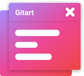
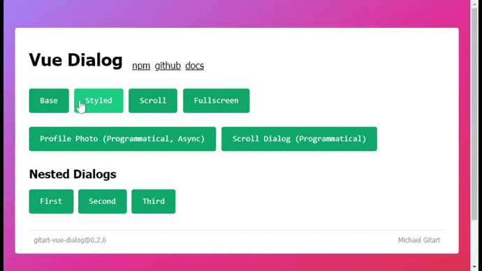

[](https://savelife.in.ua/en/)

<p align="center"></p>

<h1 align="center">Gitart Vue Dialog</h1>

<p align="center">Vue 3 dialog/modal component with optional programmatic dialog management</p>

---

📘 [Documentation](https://gitart-vue-dialog.gitart.org/)

🤯 [Examples](https://examples.gitart-vue-dialog.gitart.org/)

⭐ [You can star it here, thanks :)](https://github.com/gitart-group/vue-dialog)

TypeScript-friendly, customizable, animated, SSR-aware, accessible focus handling, and ready for both template-driven and programmatic dialogs.

## Installation

```bash
npm i gitart-vue-dialog
```

`gitart-vue-dialog` requires Vue 3 and declares `vue@^3.2.47` as a peer dependency.

Import styles once in your app entry:

```ts
import 'gitart-vue-dialog/dist/style.css'
```

## v4 Core Dialog Management

Starting with v4, `gitart-vue-dialog` uses [`gitart-manage-vue-dialog`](https://www.npmjs.com/package/gitart-manage-vue-dialog) under the hood for core dialog state management.

If you only need to manage dialogs without the styled `GDialog` UI layer, you can use `gitart-manage-vue-dialog` directly.

## What This Package Exports

- `GDialog` for styled dialogs you control with `v-model` or the `activator` slot
- `GDialogRoot` for rendering dialogs added programmatically
- `plugin` for installing the dialog manager
- `useGDialog()` for access to `addDialog()` and `removeDialog()`
- `useDialogConfirm()` for promise-based confirm dialogs
- `useDialogReturnData()` for promise-based dialogs that resolve custom data

The plugin also exposes the same manager as `this.$dialog`.

## Standalone Component

Use `GDialog` directly when you manage open state yourself:

```vue
<script setup lang="ts">
import { ref } from 'vue'
import { GDialog } from 'gitart-vue-dialog'

const opened = ref(false)
</script>

<template>
  <button @click="opened = true">
    Open dialog
  </button>

  <GDialog
    v-model="opened"
    max-width="560"
    close-on-back
  >
    <div>
      <h2>Dialog title</h2>
      <p>Dialog content</p>

      <button @click="opened = false">
        Close
      </button>
    </div>
  </GDialog>
</template>
```

`GDialog` also supports uncontrolled usage through the `activator` slot.

## Programmatic Dialogs

Use the plugin when you want to open dialogs from composables, stores, or arbitrary components.

Install the plugin once and render `GDialogRoot` near the app root:

```ts
import { createApp } from 'vue'
import App from './App.vue'
import { plugin as dialogPlugin } from 'gitart-vue-dialog'
import 'gitart-vue-dialog/dist/style.css'

createApp(App)
  .use(dialogPlugin, {
    closeDelay: 500,
  })
  .mount('#app')
```

```vue
<script setup lang="ts">
import { GDialogRoot } from 'gitart-vue-dialog'
</script>

<template>
  <RouterView />
  <GDialogRoot />
</template>
```

Open dialogs from anywhere:

```ts
import { useGDialog } from 'gitart-vue-dialog'
import MyDialog from './MyDialog.vue'

const $dialog = useGDialog()

const id = $dialog.addDialog({
  component: MyDialog,
  props: {
    title: 'Opened programmatically',
  },
}, {
  onClose: ({ id }) => {
    console.log('closing dialog', id)
  },
})

$dialog.removeDialog(id)
```

If you want the built-in styled UI, the component passed to `addDialog()` should typically render `GDialog` internally.

## Promise Helpers

`useDialogConfirm()` injects a `confirm` prop and resolves `true` or `false`.

`useDialogReturnData()` injects a `confirm` prop and resolves custom data or `null`.

Your dialog component should accept `modelValue`, emit `update:modelValue`, and call the injected `confirm` prop when it should resolve.

```ts
import { useDialogConfirm, useDialogReturnData } from 'gitart-vue-dialog'
import ConfirmDialog from './ConfirmDialog.vue'
import PickValueDialog from './PickValueDialog.vue'

const confirmDialog = useDialogConfirm(ConfirmDialog)
const pickValueDialog = useDialogReturnData<string>(PickValueDialog)

const confirmed = await confirmDialog({
  title: 'Are you sure?',
})

const value = await pickValueDialog({
  title: 'Pick a value',
})
```

## Important Built-In Behavior

- Focus is moved into the active dialog and restored on close
- Keyboard focus can be trapped inside the active dialog
- `Escape` closes only the top-most dialog
- Overlay clicks close the dialog unless `persistent` is enabled
- `closeOnBack` integrates with browser history
- `teleportTo`, `disableTeleport`, and `local` help control where the dialog is rendered
- `fullscreen`, `scrollable`, `maxWidth`, `width`, `height`, `background`, and `borderRadius` cover common layout and UI needs

## Styling

Built-in CSS custom properties:

- `--g-dialog-overlay-bg`
- `--g-dialog-content-bg`
- `--g-dialog-content-border-radius`
- `--g-dialog-content-shadow`
- `--g-dialog-transition-duration`

Read the full docs for all props, slots, and advanced usage details:

📘 [Documentation](https://gitart-vue-dialog.gitart.org/)




Made in Ukraine 🇺🇦 by [Mykhailo Kryvorucho](https://twitter.com/MichaelGitart)
